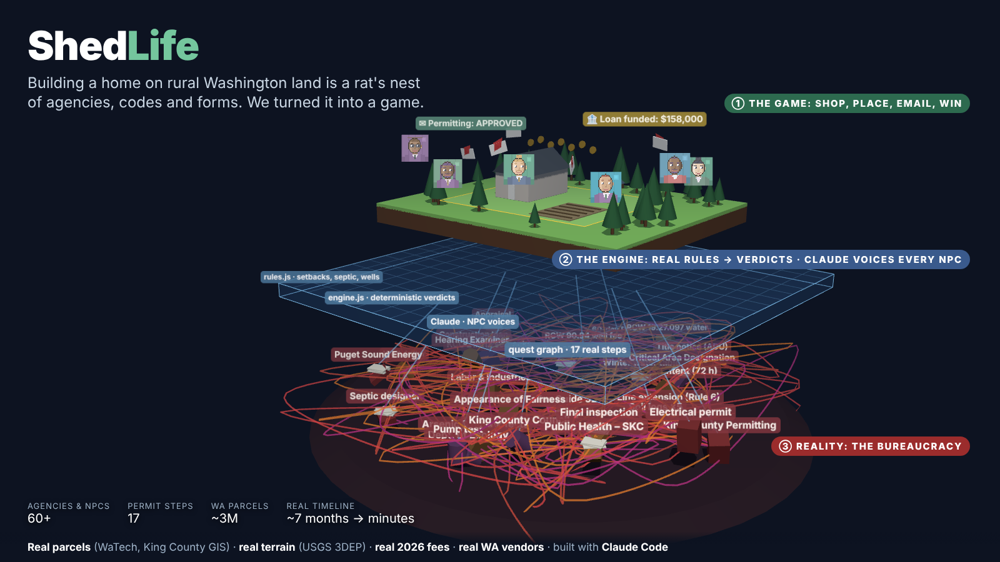

# ShedLife


**A training simulator for building a home on real Washington land — on an accelerated clock, just fun enough that it doesn't hurt.**



**Permit quest: build a home on a real piece of Washington.** You own a real vacant parcel in rural King County (PIN 8847400030, RA-5, 4.8 acres, real USGS terrain). To live there you need water, septic, power, a building permit and a final inspection — and **every move is an email**. Real agencies (King County Permitting, Public Health, Ecology, L&I, PSE) and fictional contractors answer on the game clock: approved, needs info, not yet, corrections. Claude writes every reply in character; a deterministic engine built on real King County rules and 2026 fees decides what they say.


## Docs
- [docs/SPEC.md](docs/SPEC.md): full product spec · [docs/ROADMAP.md](docs/ROADMAP.md): milestones P0–P4
- [CLAUDE.md](CLAUDE.md): guide for coding agents · [docs/wa-king-county.md](docs/wa-king-county.md): Washington research and sources · [docs/data-sources.md](docs/data-sources.md): data sources and terms

## What's in it
- **Pick any parcel in Washington** on a statewide map (WaTech parcels, ~3M; vacant = no building value). King County lots get real zoning from county GIS.
- **Shop real Washington vendors** — sheds, tiny homes, park models, modular homes, ADUs with real sizes and prices (and the hard lesson: in King County a tiny home on wheels is an RV, not a home).
- **Email every agency** in the real order; a deterministic engine built on real rules and 2026 fees decides; Claude voices every reply.
- **Talk to officials** — every seat on the King, Seattle, Bellevue, Snohomish and Pierce councils, four county commissions and the King County Hearing Examiner, as animated 16-bit portraits. The bodies are real; the people are fictional.
- **Fill in the forms, pay the bills** — agencies take real-style applications that need your parcel number and the reference numbers from earlier approvals; contractors invoice net 30, you can negotiate once, and unpaid bills turn into liens that block your loan.
- **Read the law** — a Law view quotes the actual RCW/WAC sections (from app.leg.wa.gov) and every cite in every email links to it.
- **Finance it** — you start with $100k cash. Pre-qualify at a bank, apply with plans, close after the permit; interest runs monthly; win with a mortgage.

## How it plays
1. **Draw a site plan** on the isometric map: home, well, septic drainfield (and sheds, ADU, solar, RV). Setbacks, the 100 ft well-to-drainfield rule, impervious limits and ADU/RV rules are checked live.
2. **Email the right office.** Pick a request, attach documents you've earned, send. Out of order → "not yet". Missing papers → "needs info". Site plan problems → "corrections".
3. **Run the clock** (⏭ Next mail). Approvals unlock the next steps of the real permit path: CAD → soil logs → septic design ∥ well site → Ecology NOI → drill → water adequacy → building permit → septic install, electrical, home set → final inspection.
4. **Win** by passing final inspection before day 240 without running out of $225,000. (The big prefab is a trap.)
5. Any thread to a real agency can become a **real email draft** (mailto / portal link) — you send it, never the game.

## Built with Claude
- **Claude voices the world.** `server/npc.mjs` gives Claude each NPC's persona, sourced agency knowledge, and the engine's facts; Claude must keep every fact and number. No key → scripted letters.
- **Claude Code–native repo.** `CLAUDE.md` + project skills in `.claude/skills/` (`add-county`, `add-agency-npc`, `add-quest`, `verify-regulation`, `refresh-data`, `npc-voice`, `playtest`, `draft-real-email`), a `regs-researcher` subagent, and Apify MCP in `.mcp.json` for fetching agency pages.
- **Real data:** King County parcel + zoning GIS, USGS 3DEP elevation, King County 2026 fee guides, WAC/RCW/KCC rules — see [docs/wa-king-county.md](docs/wa-king-county.md).

## Run
Copy `.env.example` to `.env` and add `ANTHROPIC_API_KEY` (plus `ANTHROPIC_WORKSPACE_ID` for user-scoped keys).
```
npm install
npm run dev          # http://localhost:5173
npm test             # rules, engine, full scripted playthrough, bundled real data
npm run simulate     # balance: optimal run per home type
npm run fetch-parcel -- 8847400030 king   # refresh parcel + elevation (King County PIN)
python3 scripts/playtest.py out/          # headless browser playthrough + screenshots
```

## Roadmap
- ✅ P0 isometric sandbox on a real parcel · ✅ WA inbox game: King County quest graph, rules engine, Claude NPCs
- Next: Kittitas County "hard mode" (water-bank mitigation), driveway/road quest, random events (failed perc, dry well, winter water table), save/load
- Later: real contractor lookups (L&I Verify a Contractor), Gmail drafts for real threads, human approval on every real-world action

Earlier California work (San Mateo / Santa Clara parcels, land-for-sale panel) still lives in `server/` and `docs/data-sources.md`. Art is original; no third-party assets.
