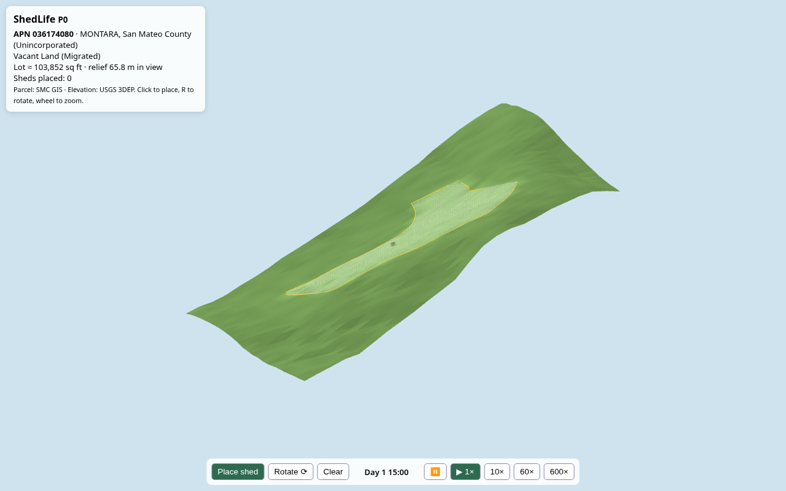

# ShedLife

SimCity for building a real property. A fully isometric Three.js browser game layered on real land, terrain, zoning and contractor data. Pick a real parcel, shape it, drop real sheds / tiny homes / RVs on it, run the clock, and work through the actual permits. The long-term goal: the same moves hire real contractors and order real structures, with human approval on every real-world action.



## P0 (this commit)
- Vite + Three.js, orthographic isometric camera, wheel zoom
- **Real parcel**: APN 036174080, vacant land in Montara (unincorporated San Mateo County), from the county's public ArcGIS REST parcel layer
- **Real terrain**: 24×24 USGS 3DEP 1 m elevation samples around the lot, flat-shaded low-poly
- 1 m grid clipped to the lot; parcel line in yellow
- Place tool for an original low-poly 8×10 shed (snaps to 0.5 m, R to rotate, red when it crosses the lot line)
- Sim clock: pause, 1×, 10×, 60×, 600× (1× = 1 game minute per second); the sun follows the clock

## Land for sale panel
Right-hand panel lists Bay Area vacant land from legitimate sources only (see [docs/data-sources.md](docs/data-sources.md)):
- **RentCast** (MLS-derived active listings, `propertyType=Land`): put `RENTCAST_API_KEY=...` in `.env` (free Developer plan at https://app.rentcast.io/app/api). Calls go through the Vite server so the key never reaches the browser; results are cached 6 h to fit the free quota.
- **County tax-defaulted sales**: download the county's official list (e.g. Santa Clara's Oct 30–Nov 2, 2026 sale spreadsheet from https://www.bid4assets.com/santaclara), save as CSV, then
  `node scripts/import-taxsale.mjs list.csv --county santa-clara --sale "Oct 30–Nov 2, 2026" --url https://www.bid4assets.com/santaclara`
"Load lot" pulls the parcel boundary from county GIS (San Mateo / Santa Clara) and terrain from USGS 3DEP via `/api/parcel` (also usable directly: `/api/parcel?lat=37.2365&lon=-121.9619` or `?apn=036174080&county=san-mateo`).

## Run
```
npm install
npm run dev          # http://localhost:5173
npm test             # node:test unit tests (geometry, clock, bundled real data)
npm run fetch-parcel -- 036174080   # refresh parcel + elevation from the live APIs (any San Mateo County APN)
```

## Roadmap
- **P0** isometric sandbox on a real parcel ✅
- **P1** terrain tools (clear, grade, cut/fill) + catalog of real structures with real dimensions and prices
- **P2** rules engine: zoning, setbacks, lot coverage, ADU and permit rules for one real jurisdiction (San Mateo County)
- **P3** contractor and vendor hooks (CSLB license lookup, quote requests, vendor links)
- **P4** real transactions, human-in-the-loop approval for every hire, order or filing

Data sources and their terms: [docs/data-sources.md](docs/data-sources.md). Art is original; no third-party assets.
