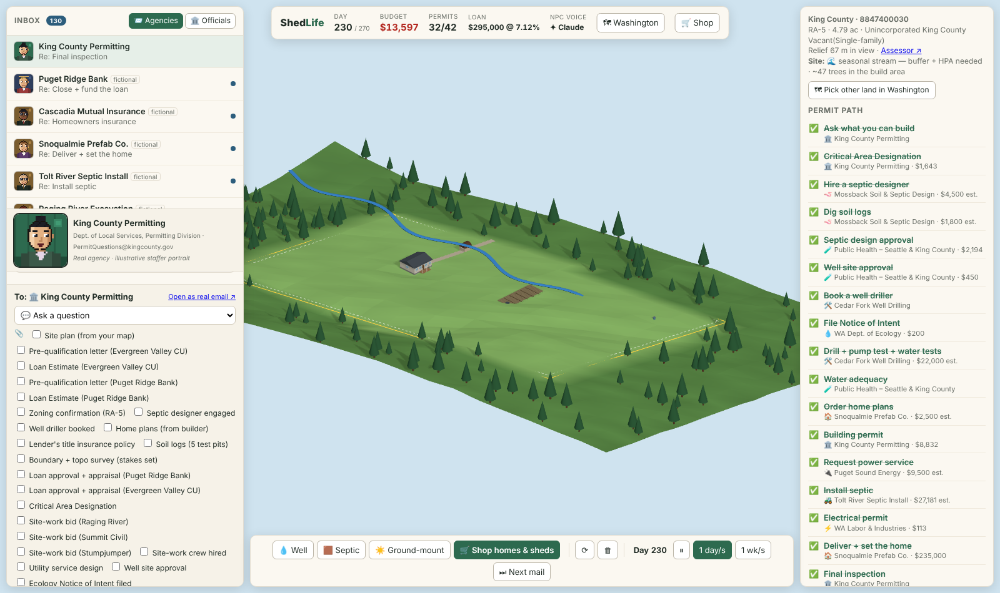

<p align="center"></p>

# ShedLife

**SimCity for building a real property.** ShedLife is a near-sim on real regulations: a training simulator for building a home on a real piece of Washington land, on an accelerated clock, made just fun enough that learning it doesn't hurt.

Built by [Rex St John](https://www.rexstjohn.com) for the **Claude for Games hackathon** (San Francisco, October 12, 2026).



## Why
There are many plots of land in great locations, but turning them into somewhere you can live takes a pile of permits that slows everything down. If that process could be automated, people could build for less. ShedLife starts by making the real process playable.

## What it is
You own a real vacant parcel in rural King County (PIN 8847400030, zoned RA-5, about 4.8 acres, real USGS terrain, with a stream). To live there you need water, septic, power, a building permit and a final inspection, and **every move is an email**. Real agencies (King County Permitting, Public Health, Ecology, L&I, PSE) and fictional contractors, banks, insurers and prefab vendors answer on the game clock: approved, needs info, not yet, corrections. A deterministic engine built on real King County rules and 2026 fees decides every outcome. Claude only writes the replies, in character.

## Features
- **Isometric 3D site plan** (Three.js) on the real parcel boundary and 3DEP terrain, with lot trees, the stream, stumps, leveled pad, driveway, day/night cycle, clouds and wildlife.
- **Pick any parcel in Washington** on a statewide Leaflet/OpenStreetMap map (WaTech parcels; vacant = no building value). King County lots get real zoning from county GIS. Place search covers WA cities and islands with live OSM fallback.
- **Inbox game.** A collapsible inbox of agencies and NPCs with unread badges, a request composer with document checkboxes, and popup conversations. Follow up, attach details, or (at a price) threaten legal action.
- **Permit Path quest log.** CAD, soil logs, septic design, well site, Ecology NOI, drilling, water adequacy, building permit, septic install, electrical, home set, final inspection, each with real 2026 fees. Tasks are grouped Do now / In motion / Up next / Later / Optional / Done.
- **Live site-plan rules** with citations: KCC 21A.12 setbacks and impervious limits, WAC 246-272A well-to-drainfield distances, ADU/RV/dwelling counts, steep slopes.
- **Government forms** with fields, hints, autofill and reference/license numbers issued on approval that later forms require.
- **Shop homes & sheds** from real Washington vendors (sheds, tiny homes, park models, modular homes, ADUs) with real sizes, prices and product-accurate 3D models. Lesson included: in King County a tiny home on wheels is an RV.
- **Site work.** Survey, stream study, WDFW HPA, clearing and grading permit; three crews bid on price, speed and rain risk; fell trees, grub and TESC, level the pad, cut the driveway. Physical prerequisites apply (pad before septic, road before delivery).
- **Money.** Budget/permits/loan HUD. Bank loan subgame (prequal at 43% DTI, appraisal, close after permit, monthly interest, convert to a 30-year mortgage), competing Loan Estimates and discount points, a land equity line, title, builder's risk and homeowners insurance.
- **Bills.** Contractors invoice net 30; negotiate once; 1.5%/month late fees; overdue work goes on hold; unpaid over 30 days becomes a lien that blocks the loan.
- **Foreman NPC** with live briefings, and a Summary screen.
- **Officials.** Every seat on the King, Seattle, Bellevue, Snohomish and Pierce councils, four county commissions and the King County Hearing Examiner, as animated procedural 16-bit portraits. The bodies are real, the people are fictional.
- **Law view.** Verbatim RCW/WAC excerpts from app.leg.wa.gov (KCC/IRC summarized); every cite in every email links to it.
- **Time controls.** `>` / `>>` / `>>>` speeds and Next mail. Win by passing final inspection before the deadline with all bills paid.
- **Real email drafts.** Any thread to a real agency can become a mailto or portal link. You send it, never the game.

## Gameplay loop
1. Draw a site plan on the map: home, well, septic drainfield, plus optional sheds, ADU, solar, RV. Rules check live.
2. Pick a request, attach the documents you've earned, fill the form, send.
3. Run the clock. Out of order gets "not yet", missing papers get "needs info", site plan problems get "corrections". Approvals unlock the next step.
4. Hire crews, buy the home, line up the loan, pay the bills.
5. Pass final inspection before the deadline without running out of money.

## Claude NPC agents
- `server/npc.mjs` (`POST /api/npc`) gives Claude each NPC's persona, sourced agency knowledge (`src/scenarios/king-county-knowledge.js`) and the engine's facts (`factsOf` in `src/letters.js`). Claude must keep every fact and number. With no API key, or on any error, scripted letters are used. The HUD shows "NPC voice Claude" when it's live.
- **The engine decides, Claude narrates.** Model output never changes game state.
- **Claude Code native repo:** [CLAUDE.md](CLAUDE.md), project skills in `.claude/skills/` (`add-county`, `add-agency-npc`, `add-official-body`, `add-vendor-product`, `add-quest`, `verify-regulation`, `refresh-data`, `npc-voice`, `playtest`, `draft-real-email`), a `regs-researcher` subagent in `.claude/agents/`, and Apify MCP in `.mcp.json`.

## Real data sources
- King County parcel and zoning GIS (PropertyInfo), WaTech statewide parcels
- USGS 3DEP elevation
- King County 2026 permit and Public Health fee guides; KCC, WAC and RCW rules (verbatim excerpts in `data/laws.json`)
- Real Washington vendor products, cited and dated (`data/wa-vendors.json`)
- WA cities (US-Cities-Database) and islands geocoded via OSM/Photon (`data/wa-places.json`)
- Earlier California work: San Mateo and Santa Clara county GIS, RentCast land listings, county tax-sale imports

Sources and notes: [docs/wa-king-county.md](docs/wa-king-county.md), [docs/data-sources.md](docs/data-sources.md).

## Repo contents
| Path | What's there |
|---|---|
| `index.html`, `src/main.js`, `src/meshes.js` | Three.js map, placement, inbox / compose / quest-log UI |
| `src/engine.js` | Pure game state: verdicts, fees, delays, tick, bills, loans, win/lose |
| `src/rules.js`, `src/catalog.js` | WA site-plan rules with citations; structures and permit classes |
| `src/letters.js` | Facts Claude must keep, plus scripted fallback letters |
| `src/scenarios/` | King County scenario (NPCs, quest graph, fees), forms, sourced agency knowledge |
| `src/officials.js`, `src/portraits.js` | Real bodies with fictional seated officials; procedural 16-bit portraits |
| `src/laws.js`, `src/data/` | Law view and generated data modules (laws, vendors, places) |
| `src/wamap.js`, `src/geo.js`, `src/wildlife.js`, `src/clock.js`, `src/autoplay.js` | Statewide map, geo helpers, ambient wildlife, sim clock, scripted player |
| `server/` | Vite middleware: Claude NPC voice, WA and CA parcel loaders, land listings, tax-sale import |
| `data/` | Source JSON: laws, vendors, places |
| `scripts/` | Parcel fetcher, vendor builder, tax-sale import, balance simulator, headless playtest |
| `test/` | node:test suites, including a full scripted playthrough |
| `docs/` | Spec, roadmap, data research, 3D stack diagram, model viewer, screenshots |
| `.claude/`, `.mcp.json`, `CLAUDE.md` | Claude Code skills, subagent, MCP config and agent guide |
| `public/` | Bundled parcel data and icons |

## Quickstart
```
npm install
cp .env.example .env    # add ANTHROPIC_API_KEY for Claude NPC voices (optional)
npm run dev             # http://localhost:5173
npm test                # rules, engine, full playthrough, bundled data
npm run simulate        # balance: optimal run per home type
npm run vendors         # regenerate src/data/vendors.js from data/wa-vendors.json
npm run fetch-parcel -- 8847400030 king   # refresh parcel + elevation
python3 scripts/playtest.py out/          # headless playthrough + screenshots (needs playwright)
```

## Environment variables
| Var | Purpose |
|---|---|
| `ANTHROPIC_API_KEY` | Claude NPC voices (scripted letters without it) |
| `ANTHROPIC_MODEL` | Model for NPC voices (default `claude-haiku-5-5` (override with `ANTHROPIC_MODEL`)) |
| `ANTHROPIC_WORKSPACE_ID` | Needed for user-scoped keys |
| `APIFY_TOKEN` | Apify MCP for fetching agency pages |
| `RENTCAST_API_KEY` | Land-for-sale listings (California panel) |

## Docs
- [CLAUDE.md](CLAUDE.md): agent guide, architecture, invariants
- [docs/SPEC.md](docs/SPEC.md): full product spec and motivation (written for the earlier California version)
- [docs/ROADMAP.md](docs/ROADMAP.md): roadmap
- [docs/data-sources.md](docs/data-sources.md), [docs/wa-king-county.md](docs/wa-king-county.md): data research

Art is original; no third-party assets. Officials are fictional; contractors are fictional; the game never sends real email.
